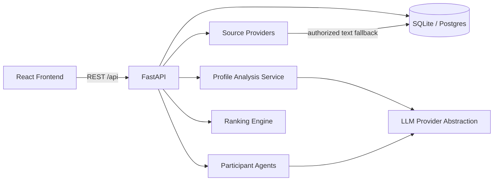

# Architecture

PAIRWISE is an agentic dating platform where each consenting adult is represented by an independent AI agent.

## Layers

1. **Source acquisition** — validates LinkedIn/Instagram URLs, applies SSRF protections, and records provenance. Automated scraping is not used when platforms block access; participants may supply authorized profile text.
2. **Profile analysis** — structured JSON analysis with evidence validation against source text. Live LLM when configured; otherwise a clearly labeled deterministic analyzer.
3. **Independent agents** — each agent sees only its own public analysis view plus the shared transcript. No private cross-reads.
4. **Dating orchestration** — bounded-concurrency multi-turn sessions with immediate message persistence, cancel/resume, and mutual evaluations.
5. **Ranking** — weighted, explainable scores from persisted analyses + evaluations (shared interests 30%, preferences 30%, conversation 25%, lifestyle 15%).

## Modes

| Mode | Data | LLM |
|------|------|-----|
| Demo | 25 synthetic participants, 300 pairs, 600 rankings | Not required; transcripts labeled demo replay |
| Live | Consented real submissions | Requires `LLM_API_KEY` |

## Security notes

- Profile text is treated as untrusted input (prompt-injection defense).
- Secrets stay in environment variables.
- Participant deletion cascades associated records.
- Sensitive traits are never inferred for ranking.
