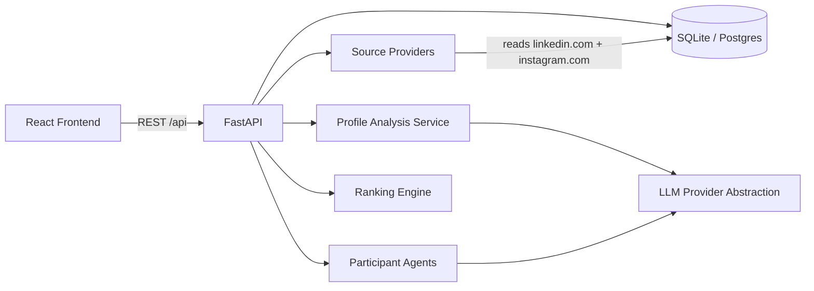

# Architecture

PAIRWISE is an agentic dating site where each person is represented by an independent agent that reads their public LinkedIn and Instagram.

## Layers

1. **Source acquisition** — validates the two URLs (SSRF-safe), reads both public profile pages live, refuses private Instagram accounts, and records how each source was read. Pasted profile text is only a fallback when a platform blocks the read.
2. **Profile analysis** — needs, hobbies, interests, values, personality, lifestyle. Every claim must quote the source text or it is dropped. LLM when configured; otherwise a labeled rule-based analyzer.
3. **Independent agents** — each agent sees only its own public analysis view plus the shared transcript. No private cross-reads.
4. **Dating orchestration** — bounded-concurrency multi-turn sessions with immediate message persistence, cancel/resume, and mutual evaluations.
5. **Ranking** — mutual session score (conversation 35%, shared interests 30%, needs and values 25%, lifestyle 10%), then a personal ranking per person: 50% own agent's verdict, 30% mutual score, 20% the other agent's verdict.

## Modes

| Mode | Data | LLM |
|------|------|-----|
| Live | Real people read from their two public links | LLM agents with `LLM_API_KEY`; rule-based agents without |
| Synthetic sample | 25 invented placeholders, shown only until a real run exists | Not used |

## Security notes

- Profile text is treated as untrusted input (prompt-injection defense).
- Secrets stay in environment variables.
- Participant deletion cascades associated records.
- Sensitive traits are never inferred for ranking.
